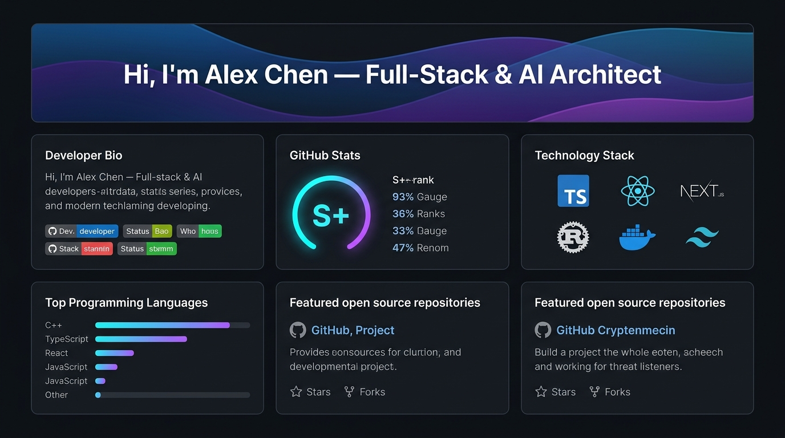

 

**GitCanvas** ingests your public GitHub portfolio, detects your developer archetype, synthesizes tailored bio copy with AI, and renders **Apple-inspired Bento Grid**, **Neofetch Terminal CLI**, and **Editorial Minimalist** READMEs with 1-click deployment to `<username>/<username>`.

  <a href="#-bento-architecture--core-capabilities"><strong>🍱 Bento Features</strong></a> ·
  <a href="#-layout-blueprints"><strong>🎨 Layout Blueprints</strong></a> ·
  <a href="#-quick-start"><strong>🚀 Quick Start</strong></a> ·
  <a href="#-tech-stack"><strong>🛠️ Tech Stack</strong></a>

---

## 🍱 Bento Architecture & Core Capabilities

<table width="100%">
  <tr>
    <td width="50%" valign="top">
      <h3>🧬 1. Portfolio Ingestion & Archetype Engine</h3>
      
Fetches public repositories, star velocity, fork metrics, and byte-level language distributions via the Octokit REST API to classify your engineering profile:

      <ul>
        <li>🎨 <b>Frontend Architect</b> — React, Next.js, TypeScript, CSS</li>
        <li>⚙️ <b>Backend & Systems</b> — Rust, Go, C++, Java, Python</li>
        <li>🧠 <b>AI & Data Specialist</b> — PyTorch, Jupyter, Python, R</li>
        <li>☁️ <b>DevOps & Cloud</b> — Kubernetes, Terraform, Docker, Shell</li>
      </ul>
      

        
        
      

    </td>
    <td width="50%" valign="top">
      <h3>🍱 2. Multi-Blueprint Markdown Generator</h3>
      
Switch seamlessly between top-rated GitHub README architectural styles with zero manual HTML/Markdown wrangling:

      <ul>
        <li>🍱 <b>Bento Grid Dashboard</b> — 2×3 modular HTML table cards</li>
        <li>💻 <b>Neofetch Terminal CLI</b> — ASCII art + system telemetry pane</li>
        <li>✨ <b>Editorial Minimalist</b> — Linear/Vercel high-signal layout</li>
        <li>🧱 <b>Classic Modular Stack</b> — Full-width vertical sections</li>
      </ul>
      

        
        
      

    </td>
  </tr>
  <tr>
    <td width="50%" valign="top">
      <h3>🖥️ 3. Real-Time GitHub Desktop Simulator</h3>
      
Split-screen visual studio with drag-and-drop block reordering and pixel-accurate GitHub dark mode (<code>#0d1117</code> / <code>#161b22</code>) preview:

      <ul>
        <li>🔄 Drag-and-drop section sorting via <code>@dnd-kit/sortable</code></li>
        <li>👁️ Instant toggle between rendered Bento preview & raw Markdown</li>
        <li>🤖 AI Bio Synthesizer with 4 tones (<i>Professional, Minimalist, Playful, Storyteller</i>)</li>
      </ul>
      

        
        
      

    </td>
    <td width="50%" valign="top">
      <h3>🚀 4. Direct GitHub Repository Deployer</h3>
      
Commit your generated <code>README.md</code> directly to your special <code>&lt;username&gt;/&lt;username&gt;</code> profile repository without leaving the browser:

      <ul>
        <li>🔍 Auto-verifies & initializes <code>&lt;username&gt;/&lt;username&gt;</code> if missing</li>
        <li>📊 Unified side-by-side <b>Diff Preview Modal</b> before committing</li>
        <li>🔐 Supports GitHub OAuth (NextAuth) or Personal Access Tokens</li>
      </ul>
      

        
        
      

    </td>
  </tr>
</table>

---

## 🎨 Layout Blueprints

| Blueprint | Aesthetic | Key Components | Best For |
|:----------|:----------|:---------------|:---------|
| **🍱 Bento Grid** *(Default)* | Apple-style modular dark cards | Wave header, 2×3 HTML card matrix, S+ rank gauge, compact language bars, 2-col repo cards | Full-Stack, Product & AI Engineers |
| **💻 Terminal CLI** | `neofetch` / Tokyo Night hacker | Monospace `user@gitcanvas` telemetry block, side-by-side stats & streak, CLI repo table | Systems, Rust/Go & DevOps Engineers |
| **✨ Editorial Minimal** | Linear / Vercel / Shadcn | Centered flat-square badges, 2×2 focus matrix, restrained typography | Staff Engineers & Open-Source Maintainers |
| **🧱 Classic Stack** | Traditional GitHub Profile | Full-width stacked sections separated by horizontal dividers | General Developer Portfolios |

---

## 🛠️ Tech Stack

<table width="100%">
  <tr>
    <td width="33%" valign="top">
      <h4>⚡ Core & Frontend</h4>
      

        
        
        
        
      

    </td>
    <td width="33%" valign="top">
      <h4>🧩 Studio & Markdown</h4>
      

        
        
        
        
      

    </td>
    <td width="34%" valign="top">
      <h4>☁️ APIs & Authentication</h4>
      

        
        
        
      

    </td>
  </tr>
</table>

---

## 🚀 Quick Start

<table width="100%">
  <tr>
    <td width="50%" valign="top">
      <h4>1. Clone & Install</h4>
      <pre lang="bash"><code>git clone https://github.com/ElXprogramming/GitCanvas.git
cd GitCanvas
npm install</code></pre>
      <h4>2. Launch Development Studio</h4>
      <pre lang="bash"><code>npm run dev</code></pre>
      
Open <a href="http://localhost:3000">http://localhost:3000</a> to preview and customize your Bento Grid README live.

    </td>
    <td width="50%" valign="top">
      <h4>3. Optional Environment Variables (<code>.env.local</code>)</h4>
      <pre lang="ini"><code># Optional GitHub OAuth for 1-click session login
GITHUB_ID=""
GITHUB_SECRET=""

# Server token for higher public API rate limits
GITHUB_TOKEN="ghp_..."

# NextAuth configuration
NEXTAUTH_URL="http://localhost:3000"
NEXTAUTH_SECRET="your-32-character-secret"

# Optional Gemini API key for AI bio synthesis
GEMINI_API_KEY=""</code></pre>
    </td>
  </tr>
</table>

---

  Built with precision for developers • MIT License © <a href="https://github.com/ElXprogramming/GitCanvas">GitCanvas</a>

