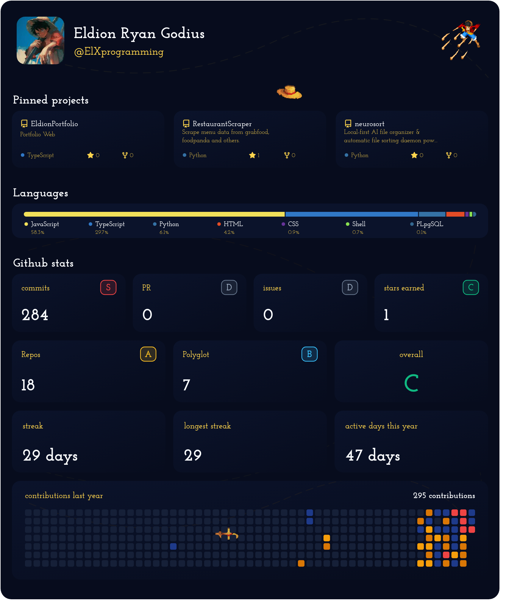

<div align="center">


[](https://github.com/ElXprogramming/GitCanvas/releases)
[](https://github.com/ElXprogramming/GitCanvas/actions/workflows/ci.yml)
[](https://nextjs.org/)
[](https://www.typescriptlang.org/)
[](https://tailwindcss.com/)
[](https://githubstatreadme.vercel.app)
[](https://github.com/ElXprogramming/GitCanvas)
[](LICENSE)
[](https://github.com/ElXprogramming/GitCanvas/stargazers)

<br />

**GitCanvas** is a high-performance **Dynamic SVG Profile Card Generator & Interactive README Studio** for GitHub. It aggregates your GitHub portfolio via a unified GraphQL query, classifies your developer archetype, synthesizes tailored bio copy with AI, and renders gorgeous borderless SVG cards with animated One Piece pixel themes, modern developer palettes, and curated digital typography.

<p align="center">
  <a href="#-quick-embed"><strong>⚡ Quick Embed</strong></a> ·
  <a href="#-core-capabilities"><strong>✨ Features</strong></a> ·
  <a href="#-svg-card-api-reference"><strong>📡 Card API</strong></a> ·
  <a href="#-themes--typography"><strong>🎨 Themes & Fonts</strong></a> ·
  <a href="#-quick-start"><strong>🚀 Quick Start</strong></a> ·
  <a href="#-tech-stack"><strong>🛠️ Tech Stack</strong></a>
</p>

<p align="center">
  <a href="https://githubstatreadme.vercel.app" target="_blank" title="Launch GitCanvas Studio Live Deployment">
    
  </a>
</p>

</div>

---

## ⚡ Quick Embed

Add a complete, live-updating profile dashboard to your GitHub Profile README with a single line of Markdown:

```markdown

```

<div align="center">
  <br />
  <p><b>✨ Live Dynamic Composite Card Output (Luffy Gatling Theme & Josefin Slab Typography)</b></p>
  <a href="https://githubstatreadme.vercel.app/api/card?username=ElXprogramming&theme=onepiece_gatling&font=josefin_slab" target="_blank" title="View Live SVG Card Render">
    
  </a>
  <p><sub><i>Live output generated directly from production deployment • Real-time GraphQL metrics & animated One Piece pixel art</i></sub></p>
  <br />
</div>

Or embed standalone modular cards anywhere in your markdown:

```markdown
<!-- Graded Streak Stats -->


<!-- Language Distribution Bar -->


<!-- Pinned Project Card -->

```

---

## ✨ Core Capabilities

<table width="100%">
  <tr>
    <td width="50%" valign="top">
      <h3>🖼️ 1. Dynamic Composite Canvas SVG</h3>
      <p>Render your entire GitHub presence in a single, high-performance SVG image without fragile HTML tables or markdown layout drift:</p>
      <ul>
        <li>👤 <b>Profile Header</b> — Avatar, display name, bio, and company</li>
        <li>📌 <b>Live Pinned Repos</b> — Auto-synced repository cards with stars & forks</li>
        <li>📊 <b>Byte-Weighted Languages</b> — Compact, borderless progress bar</li>
        <li>🏆 <b>Graded Metrics</b> — Commits, PRs, issues, stars, and polyglot scores</li>
        <li>🔥 <b>Streak & Habits</b> — Current streak, longest streak, and active days</li>
        <li>🟩 <b>Contribution Matrix</b> — Visual commit heatmap calendar</li>
      </ul>
      <p>
        
        
      </p>
    </td>
    <td width="50%" valign="top">
      <h3>👒 2. Animated Themes & Pixel Art</h3>
      <p>Elevate your profile with vibrant developer aesthetics and exclusive animated One Piece pixel artwork:</p>
      <ul>
        <li>🥊 <b>Luffy Gatling (Animated GIF)</b> — High-speed punch animation with background wind effects and flapping straw hats</li>
        <li>⚡ <b>Sun God Nika (Gear 5)</b> — Radiant gold & violet celestial styling</li>
        <li>⚔️ <b>Wano Zoro</b> — Emerald katana accents and character pixel art</li>
        <li>🌌 <b>Developer Themes</b> — Tokyo Night, Catppuccin Mocha, Dracula, Nord, Radical, Sunset, and GitHub Dark</li>
      </ul>
      <p>
        
        
      </p>
    </td>
  </tr>
  <tr>
    <td width="50%" valign="top">
      <h3>🔤 3. Curated Digital Typography</h3>
      <p>10+ top-rated, easy-on-the-eyes Google Fonts engineered for digital readability and embedded seamlessly into SVGs:</p>
      <ul>
        <li>📜 <b>Josefin Slab</b> <i>(Default)</i> — Vintage Scandinavian geometric slab</li>
        <li>🖥️ <b>Inter & Roboto</b> — Screen-first modern sans-serif standards</li>
        <li>⌨️ <b>Fira Code</b> — Monospace with high contrast & zero ambiguity</li>
        <li>👁️ <b>Lexend</b> — Scientifically tuned for dyslexia & low eye strain</li>
        <li>📖 <b>Merriweather & Lora</b> — Gentle, editorial screen serifs</li>
      </ul>
      <p>
        
        
      </p>
    </td>
    <td width="50%" valign="top">
      <h3>🧬 4. Portfolio Ingestion & AI Bio Studio</h3>
      <p>Intelligent GitHub data extraction paired with AI synthesis and real-time simulator controls:</p>
      <ul>
        <li>🧬 <b>Archetype Engine</b> — Auto-classifies into Frontend Architect, Backend Specialist, AI/Data, DevOps, or Fullstack</li>
        <li>🤖 <b>Gemini AI Bio Synthesizer</b> — Crafts custom bio copy across 4 tones (<i>Professional, Minimalist, Playful, Storyteller</i>)</li>
        <li>🎛️ <b>Interactive Studio</b> — Reorder sections, pick tech badges, toggle bio fields, and preview live in GitHub Dark mode</li>
        <li>📋 <b>1-Click Copy</b> — Copy instant Markdown embed code or direct image URLs</li>
      </ul>
      <p>
        
        
      </p>
    </td>
  </tr>
</table>

---

## 📡 SVG Card API Reference

GitCanvas provides high-performance SVG generation endpoints that can be embedded into any GitHub README or web page.

**Live Production Base URL:** `https://githubstatreadme.vercel.app`

### 1. Unified Canvas Card Endpoint

Renders the full composite profile card containing all dashboard modules.

```http
GET https://githubstatreadme.vercel.app/api/card?username={username}&theme={theme}&font={font}
GET https://githubstatreadme.vercel.app/api/cards/canvas?username={username}&theme={theme}&font={font}
```

#### Query Parameters

| Parameter | Type | Default | Description |
|:---|:---|:---|:---|
| `username` *(or `user`)* | `string` | **Required** | GitHub username to fetch stats and portfolio data for. |
| `theme` | `string` | `default` | Color theme (`onepiece_gatling`, `wano_zoro`, `tokyonight`, `catppuccin_mocha`, `dracula`, `nord`, `github_dark`, `radical`, `sunset`). |
| `font` | `string` | `josefin_slab` | Font family (`josefin_slab`, `inter`, `fira_code`, `roboto`, `open_sans`, `lato`, `plus_jakarta_sans`, `dm_sans`, `lexend`, `merriweather`, `lora`). |
| `name` | `string` | Profile name | Custom display name override on the header card. |
| `tagline` | `string` | Archetype label | Custom subtitle / tagline text. |
| `show_company` | `boolean` | `false` | Set to `1` or `true` to display company name on the profile card. |
| `company` | `string` | GitHub company | Custom company name override. |
| `show_bio` | `boolean` | `false` | Set to `1` or `true` to display bio text on the profile card. |
| `bio_text` | `string` | GitHub bio | Custom bio text override. |
| `hide_profile` | `boolean` | `false` | Set to `1` or `true` to hide the top profile banner. |
| `sections` | `string` | All | Comma-separated list of active sections (`pinned_projects`, `tech_stack`, `github_stats`, `streak_trophies`, `bio`) or `none`. |
| `repos` | `string` | Live pinned | Comma-separated repository names to display instead of default pinned repositories. |
| `hide_rows` | `string` | `none` | Comma-separated rows to hide (`r1` for stats boxes, `r2` for language distribution bar). |
| `mascot` | `string` | Theme default | Mascot character identifier (`luffy_gatling`, `straw_hat`, `luffy`, `zoro`). |
| `refresh` | `boolean` | `false` | Set to `true` to bypass cache and fetch fresh data from GitHub. |

---

### 2. Standalone Modular Item Endpoints

Embed individual card widgets anywhere in your README:

```http
GET https://githubstatreadme.vercel.app/api/cards/{item}?username={username}&theme={theme}&font={font}
```

| Route Item | Output Description | Live Sample URL |
|:---|:---|:---|
| `profile` | Profile banner with avatar, stats, bio, and company | [`/api/cards/profile?username=ElXprogramming&theme=onepiece_gatling`](https://githubstatreadme.vercel.app/api/cards/profile?username=ElXprogramming&theme=onepiece_gatling) |
| `pinned` *(or `project`)* | Pinned repository card (`index=0`, `repo=repo-name`) | [`/api/cards/pinned?username=ElXprogramming&index=0&theme=tokyonight`](https://githubstatreadme.vercel.app/api/cards/pinned?username=ElXprogramming&index=0&theme=tokyonight) |
| `languages` | Compact byte-weighted language distribution bar | [`/api/cards/languages?username=ElXprogramming&theme=catppuccin_mocha`](https://githubstatreadme.vercel.app/api/cards/languages?username=ElXprogramming&theme=catppuccin_mocha) |
| `overall` | Graded overall engineer score with letter tier (S+, S, A, B, C) | [`/api/cards/overall?username=ElXprogramming&theme=dracula`](https://githubstatreadme.vercel.app/api/cards/overall?username=ElXprogramming&theme=dracula) |
| `streak` | Current streak, longest streak, and active days summary | [`/api/cards/streak?username=ElXprogramming&theme=onepiece_gatling`](https://githubstatreadme.vercel.app/api/cards/streak?username=ElXprogramming&theme=onepiece_gatling) |
| `contributions` | Year-round contribution calendar matrix heatmap | [`/api/cards/contributions?username=ElXprogramming&theme=nord`](https://githubstatreadme.vercel.app/api/cards/contributions?username=ElXprogramming&theme=nord) |
| `commits` | Total commits box with performance tier badge | [`/api/cards/commits?username=ElXprogramming&theme=radical`](https://githubstatreadme.vercel.app/api/cards/commits?username=ElXprogramming&theme=radical) |
| `prs` | Total pull requests submitted with grading | [`/api/cards/prs?username=ElXprogramming&theme=tokyonight`](https://githubstatreadme.vercel.app/api/cards/prs?username=ElXprogramming&theme=tokyonight) |
| `issues` | Total closed & open issues box | [`/api/cards/issues?username=ElXprogramming&theme=sunset`](https://githubstatreadme.vercel.app/api/cards/issues?username=ElXprogramming&theme=sunset) |
| `stars` | Total stars earned across repositories | [`/api/cards/stars?username=ElXprogramming&theme=catppuccin_mocha`](https://githubstatreadme.vercel.app/api/cards/stars?username=ElXprogramming&theme=catppuccin_mocha) |
| `repos` | Total public repositories count & grade | [`/api/cards/repos?username=ElXprogramming&theme=github_dark`](https://githubstatreadme.vercel.app/api/cards/repos?username=ElXprogramming&theme=github_dark) |
| `polyglot` | Polyglot score based on language diversity | [`/api/cards/polyglot?username=ElXprogramming&theme=dracula`](https://githubstatreadme.vercel.app/api/cards/polyglot?username=ElXprogramming&theme=dracula) |
| `social` | Minimal borderless social link (`type=github`, `type=linkedin`) | [`/api/cards/social?type=github&label=GitHub&theme=tokyonight`](https://githubstatreadme.vercel.app/api/cards/social?type=github&label=GitHub&theme=tokyonight) |

---

## 🎨 Themes & Typography

### Curated Color Themes

| Theme ID | Name | Category | Aesthetic Description |
|:---|:---|:---|:---|
| `onepiece_gatling` | **Luffy Gatling** | ⭐ Showcase | Deep navy & vibrant Straw Hat gold, animated Luffy Gatling GIF, roaming straw hats & golden wind trails |
| `wano_zoro` | **Wano Zoro** | ⭐ Showcase | Deep emerald & bamboo green, comedic Cross-Card Wanderer Zoro (animated SMIL SVG), falling Wano cherry blossoms (sakura) & flying slashes |
| `tokyonight` | **Tokyo Night** | Modern Dev | Deep navy/slate tones with vibrant cyan, pastel purple, and soft pink accents |
| `catppuccin_mocha` | **Catppuccin Mocha** | Modern Dev | Soothing pastel palette with mauve, lavender, peach, and mint green highlights |
| `dracula` | **Dracula** | Modern Dev | Classic dark vampire palette with gothic purple, neon pink, and bright cyan |
| `nord` | **Nord** | Modern Dev | Arctic, north-bluish clean palette with cool gray slate and ice blue |
| `github_dark` | **GitHub Dark** | Classic Dev | Native GitHub dark mode (`#0d1117`) with crisp white text and green accents |
| `radical` | **Radical** | Vibrant Dev | Retro-synthwave dark violet with neon teal and electric magenta |
| `sunset` | **Sunset** | Vibrant Dev | Twilight plum purple with fiery coral, peach, and warm rose accents |
| `default` | **Default Dark** | Clean Dev | Deep charcoal black-slate with clean ruby red accents and high contrast |

---

### Curated Screen Typography

All fonts are dynamically served via Google Fonts with zero-flicker SVG imports:

| Font ID | Label | Category | Badge | Characteristics |
|:---|:---|:---|:---|:---|
| `josefin_slab` | **Josefin Slab** *(Default)* | Vintage Slab | Classic Default | Scandinavian geometric slab serif with 1930s vintage character |
| `inter` | **Inter** | Modern Sans | #1 UI Standard | Engineered specifically for computer screens with tall x-height |
| `fira_code` | **Fira Code** | Developer Mono | Dev Monospace | Distinct character forms, clear operators, zero ambiguity |
| `roboto` | **Roboto** | Clean Sans | Google Flagship | Dual-nature neo-grotesque skeleton with friendly open curves |
| `open_sans` | **Open Sans** | Humanist Sans | Ultra Readable | Wide vertical letterforms with open counters to reduce eye strain |
| `lato` | **Lato** | Humanist Sans | Warm & Balanced | Harmonious proportions with warm semi-rounded details |
| `plus_jakarta_sans` | **Plus Jakarta Sans** | Geometric Sans | Airy & Modern | Modern geometric proportions with generous text spacing |
| `dm_sans` | **DM Sans** | Geometric Sans | Crisp Precision | Low-contrast geometric shapes engineered for high-DPI displays |
| `lexend` | **Lexend** | Accessibility Sans | Low Strain | Scientifically designed to reduce visual stress & boost reading speed |
| `merriweather` | **Merriweather** | Screen Serif | Editorial Screen | Sturdy screen-first serif with squarish curves for prolonged focus |
| `lora` | **Lora** | Contemporary Serif | Calligraphic | Brushed curves and fluid transitional serifs for elegant reading |

---

## ⚡ Architecture & Performance Standards

GitCanvas is built from the ground up for millisecond-level responsiveness, memory efficiency, and resilience against GitHub API rate limits:

1. **Single-Query GraphQL Data Aggregation**
   - Retrieves profile info, pinned repositories, language statistics, commit history, and the 52-week contribution calendar in a single network round-trip instead of serial REST waterfalls.
2. **In-Flight Promise Coalescing**
   - Shared promise maps (`inflightGraphQL`) deduplicate concurrent incoming requests for the same username, completely eliminating the thundering herd problem.
3. **Bounded LRU Memory Cache**
   - `BoundedMemoryCache` enforces explicit memory capacity (`maxSize: 500`) with TTL expiry, preventing unbounded memory leaks while providing instant responses for cached users.
4. **GitHub Camo Proxy Compatibility**
   - Implements native SVG SMIL animations (`<animate>`, `<animateTransform>`) and inline CSS keyframes so animated elements (such as flapping straw hats and wind particles) play flawlessly through GitHub's caching image proxy (`camo.githubusercontent.com`).
5. **High-Performance SVG Generation**
   - Single-pass regex lookup tables (`XML_ESCAPE_MAP`) instead of chained `.replace()` calls.
   - Redundant `@import url(...)` font declarations are stripped from sub-elements and unified in the root `<defs>`.
   - Layout coordinates and matrix offsets are precomputed outside hot loops.
6. **Automated Test Coverage**
   - 48 automated tests covering streak algorithms, archetype classification, LRU eviction, SVG rendering, XML escaping, and Camo compatibility, executing in <300ms via `npm test`.

---

## 🛠️ Tech Stack

<table width="100%">
  <tr>
    <td width="33%" valign="top">
      <h4>⚡ Core & Framework</h4>
      <p>
        
        
        
        
      </p>
    </td>
    <td width="33%" valign="top">
      <h4>🧩 Studio & Visuals</h4>
      <p>
        
        
        
        
      </p>
    </td>
    <td width="34%" valign="top">
      <h4>☁️ APIs & Intelligence</h4>
      <p>
        
        
        
        
      </p>
    </td>
  </tr>
</table>

---

## 🚀 Quick Start

### 1. Clone & Install

```bash
git clone https://github.com/ElXprogramming/GitCanvas.git
cd GitCanvas
npm install
```

### 2. Configure Environment Variables (`.env.local`)

Copy `.env.example` to `.env.local`:

```bash
cp .env.example .env.local
```

Configure your environment variables:

```ini
# Optional GitHub Personal Access Token for higher API rate limits (5,000 req/hr)
GITHUB_TOKEN="ghp_your_personal_access_token_here"

# Optional Gemini API Key for AI Bio Synthesis
GEMINI_API_KEY="your_google_gemini_api_key_here"

# App URL for base asset resolution
NEXT_PUBLIC_APP_URL="http://localhost:3000"
```

### 3. Run Development Studio

```bash
npm run dev
```

Open [http://localhost:3000](http://localhost:3000) in your browser to launch the GitCanvas Studio.

### 4. Run Verification & Tests

```bash
# Run unit test suite (48 tests in ~300ms)
npm test

# Run ESLint validation
npm run lint

# Run production build
npm run build
```

---

## 🤝 Contributing & Security

Contributions, themes, and bug reports are welcome! Please review [CONTRIBUTING.md](CONTRIBUTING.md), our [Code of Conduct](CODE_OF_CONDUCT.md), and [SECURITY.md](SECURITY.md).

---

## 📄 License

Distributed under the **MIT License**. See `LICENSE` for details.

<div align="center">
  <sub>Built with precision for developers • © <a href="https://github.com/ElXprogramming/GitCanvas">GitCanvas</a></sub>
</div>
